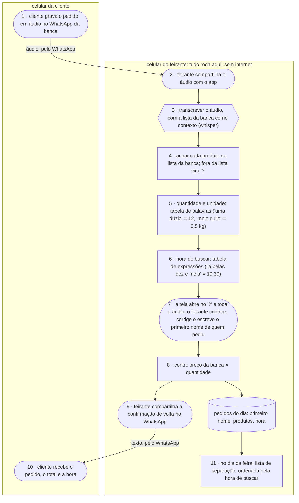

# rastro da banca · fluxograma e arquitetura

O caminho de um pedido, do áudio da cliente até a confirmação que volta para ela. Exemplo do
artefato **fluxograma e arquitetura** da disciplina AI4Good
([guia](https://lucassf.pages.dev/ai4good/flx)).

Formas: **pessoa** `([ ])` · **IA** `{{ }}` · **regra** `[ ]`. Caixas: onde cada peça roda.

## os dados

| dado pessoal | de quem é | onde fica | quem vê | por quanto tempo |
|:--|:--|:--|:--|:--|
| áudio do pedido (a voz) | cliente | cópia no app, no celular do feirante | feirante | até o pedido ser confirmado; o app apaga a cópia |
| texto transcrito | cliente | memória do app | ninguém além do app | some com o áudio |
| primeiro nome e pedido | cliente | pedidos do dia, no celular do feirante | feirante | até o fim da feira; fica só o total vendido, sem nome |
| registro de correções (sem áudio nem nome) | da banca | celular do feirante | feirante, e a pesquisa se ele aceitar | até o fim do experimento |

Nada sai do celular do feirante além da confirmação, pelo WhatsApp que a banca já usa. O app não
guarda telefone: a conversa já está no WhatsApp.
