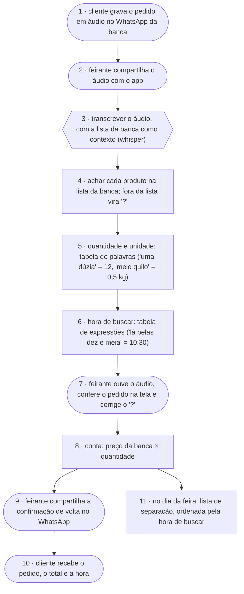

# rastro da banca · fluxograma e arquitetura

O caminho de um pedido, do áudio da cliente até a confirmação que volta para ela. Exemplo do
artefato **fluxograma e arquitetura** da disciplina AI4Good
([guia](https://lucassf.pages.dev/ai4good/flx)).

Formas: **pessoa** `([ ])` · **IA** `{{ }}` · **regra** `[ ]`.

